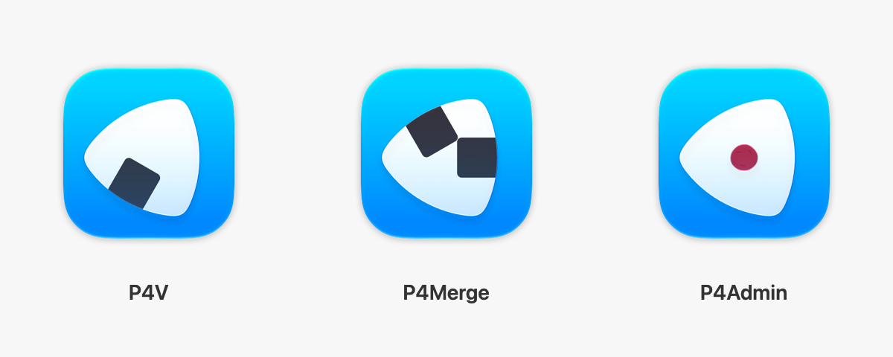
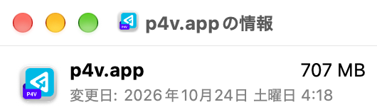

# Perforce P4 Alternative App Icons

Unofficial alternative macOS application icons for **Perforce P4V, P4Merge, and P4Admin**.

Inspired by compact, satisfying onigiri and the smooth, continuous motion of rotary engine rotors, these icons express a simple idea: capable tools, neatly packed and close at hand, to keep your work moving.

## Preview



## Downloads

Open [GitHub Releases](https://github.com/watr/perforce-p4-alternative-app-icons/releases) and look under **Assets** for `P4-Alternative-App-Icons.zip` (all three PNGs) or an individual PNG.

You can also open an individual PNG here and choose **Download raw file**.

| Application | PNG |
|---|---|
| **P4V** | [P4V.png](icons/P4V.png) |
| **P4Merge** | [P4Merge.png](icons/P4Merge.png) |
| **P4Admin** | [P4Admin.png](icons/P4Admin.png) |

ICNS files are also available for [P4V](icons/P4V.icns), [P4Merge](icons/P4Merge.icns), and [P4Admin](icons/P4Admin.icns).

These replace only the macOS app icons; the applications and their internal icons remain unchanged.

## Installation

If you are viewing the app on the mounted Perforce disk image, copy it to **Applications** first. Apply the icon to the installed copy.

1. Download the **PNG** for your application. If you downloaded the ZIP, double-click it in Finder to extract the PNGs.
2. Open the PNG in **Preview**, then select all (`⌘A`) and copy (`⌘C`).
3. In **Finder**, select the application and press `⌘I` to open **Get Info**.
4. Click the small icon next to the application name, just below the title bar, and paste (`⌘V`).

   

You may need to restart the application or refresh the Dock for the new icon to appear.

To restore the original icon, select the custom icon in the Get Info window and press `Delete`.

## Source Files

The `P4_p4v.icon`, `P4_p4merge.icon`, and `P4_p4admin.icon` folders are editable **Icon Composer** documents. `P4_base.icon` contains the shared design and symbol variants.

To rebuild the icons and preview on macOS, select **Xcode 27 or later** with `xcode-select`, then run:

```sh
bash scripts/export-icons.sh
```

The PNG and ICNS exports capture the default macOS appearance using Icon Composer design generation 27.

## Disclaimer

This unofficial project is not affiliated with, endorsed by, or sponsored by Perforce Software.

Perforce, P4, P4V, P4Merge, and P4Admin are trademarks or product names of their respective owners. All application rights remain with their respective owners.
